# Forum App — Cloud Deploy

> **⚠️ Superseded** (2026-08-04). This repository reflects the real TP8
> submission as built in July 2026 for Software Engineering III at UCC —
> unlike this series' TP7 predecessor, it was not a raw, untouched academic
> mirror when work on it stopped; it already carried real ADRs, rules
> files, and documentation of its own.
>
> This repository has been superseded by
> [`forum-app-cloud-deploy`](https://github.com/CarpinetiOctavio/forum-app-cloud-deploy),
> built as a clean copy of `forum-app-qa-pipeline@v1.0.0` rather than
> continued from this codebase. See
> [`ADR-000`](https://github.com/CarpinetiOctavio/forum-app-cloud-deploy/blob/main/docs/decisions/ADR-000-starting-from-qa-pipeline-v1.0.0.md)
> in that repository for the full reasoning behind that decision — in
> short: this repository's backend never actually descended from
> `qa-pipeline@v1.0.0` despite its own docs claiming otherwise, it predates
> `ci-testing`'s own security hardening, and its `EditPost`/`EditComment`
> functionality never existed here at all. This repository is kept
> archived, untouched (one exception: see [Update](#update-2026-11-10)), as the reference the two audits behind that
> decision — [`cloud-deploy-legacy-audit-results.md`](docs/audits/cloud-deploy-legacy-audit-results.md)
> and [`cloud-deploy-legacy-transferable-knowledge-results.md`](docs/audits/cloud-deploy-legacy-transferable-knowledge-results.md) —
> were run against.
>
> **Note on the Live Environments below**: the spoofable authentication
> design documented in the audit above was confirmed exploitable against
> this repository's real, deployed QA service — reproduced independently
> twice, once by Claude and once by Octavio himself by hand. All 4 Render
> services listed below have since been ~~**suspended** (reversible, not deleted)~~ **deleted** (2026-11-10; see [Update](#update-2026-11-10), item 1)
> as a direct consequence of that finding; the links no longer
> resolve to a running application.

### Update (2026-11-10)

This repository was unarchived once, on 2026-11-10, to make the changes listed here, and archived again. Nothing was removed from the text: statements that are no longer true, or never were, are struck through and point to this list. The audits linked above remain the full record.

1. **Render services deleted.** All 4 services were deleted on 2026-11-10; the note above said they were only suspended. The URLs in [Live Environments](#live-environments) are kept as text, no longer linked, because those subdomains can be assigned to other services.
2. **"Issues Resolved: 47" was wrong.** SonarCloud never recorded more than 31 issues for this project, and 6 were resolved; the figure was copied from a README template ([audit](docs/audits/cloud-deploy-legacy-audit-results.md), §6).
3. **The pipeline trigger is misstated.** It runs on pushes to `main`, `master` and `develop`, and the last two deploy to QA ([audit](docs/audits/cloud-deploy-legacy-audit-results.md), §0 and §4).
4. **The docs describe a different deploy mechanism.** `ADR-002-hosting.md`, `deployment.md`, `pipeline.md` and `constraints.md` describe deploy hooks, and `ADR-002-hosting.md` and `deployment.md` name two services; the implementation uses Render's REST API with an account-scoped key and four services ([audit](docs/audits/cloud-deploy-legacy-audit-results.md), §0, §4 and §6).
5. **The backend's origin is misstated.** `constraints.md` and `testing.md` say it was inherited from `qa-pipeline`; it descends from `ci-testing@v1.0.0`, without that repository's security hardening ([audit](docs/audits/cloud-deploy-legacy-audit-results.md), §2).
6. **`testing.md` overstates the tests.** It says handlers and repositories are covered by the Cypress tests, but all 15 are mocked and never reach the backend; it also cites 89 tests, a count that matches nothing real ([audit](docs/audits/cloud-deploy-legacy-audit-results.md), §1 and §6).
7. **Repository links corrected.** After the 2026-08-04 rename, `forum-app-cloud-deploy` is a different repository; the clone command and the repository link at the end now point here.
8. **A real Render API key was committed** to `docs/COMMANDS.md` in `3678eb6` (2026-07-01). It was found by hand, with no automated check in place, removed from the file the same day (`b96aef5`) and rotated ([ADR-007](docs/decisions/ADR-007-deployment-issues.md), (e); [transferable knowledge](docs/audits/cloud-deploy-legacy-transferable-knowledge-results.md), §5). It is still readable in the history; every API key on that Render account was deleted on 2026-11-10.
9. **The CI badge is red.** The [last run](https://github.com/CarpinetiOctavio/forum-app-cloud-deploy-legacy/actions/runs/30940796014) (2026-08-04) failed in `Docker Build & Push`. Its logs have expired, so the cause can no longer be checked. The workflow was disabled on 2026-11-10, so that no push publishes images to the container packages the successor repository now uses.

What still holds: the test and coverage figures in this README were re-run twice in the audit and are accurate ([audit](docs/audits/cloud-deploy-legacy-audit-results.md), §1).

[](https://github.com/CarpinetiOctavio/forum-app-cloud-deploy-legacy/actions/workflows/ci.yml)
[](https://sonarcloud.io/summary/new_code?id=CarpinetiOctavio_forum-app-cloud-deploy-legacy)
[](LICENSE)

**Author:** Octavio Carpineti
**Course:** Software Engineering III — Universidad Católica de Córdoba (UCC)
**Year:** 2025

Full-stack forum application containerized and deployed to the cloud with a complete CI/CD pipeline. This project is the third in a series: [forum-app-ci-testing](https://github.com/CarpinetiOctavio/forum-app-ci-testing) established the unit testing foundation and GitHub Actions integration, [forum-app-qa-pipeline](https://github.com/CarpinetiOctavio/forum-app-qa-pipeline) extended that with code coverage gates, static analysis, and E2E testing, and this repository adds Docker containerization, a container registry, and automated deployment to QA and production environments on Render via GitHub Actions.
---

## Table of Contents

1. [Project Description](#project-description)
2. [Live Environments](#live-environments)
3. [App Screenshots](#app-screenshots)
4. [Pipeline & Infrastructure](#pipeline--infrastructure)
5. [Tech Stack](#tech-stack)
6. [Prerequisites](#prerequisites)
7. [Installation](#installation)
8. [Running the Project](#running-the-project)
9. [Running Tests](#running-tests)
10. [Quality Tools](#quality-tools)
11. [CI/CD Pipeline](#cicd-pipeline)
12. [Docker & Cloud Deploy](#docker--cloud-deploy)
13. [Project Structure](#project-structure)
14. [Troubleshooting](#troubleshooting)
15. [Metrics](#metrics)

---

## Project Description

A mini social network built with React (frontend) and Go (backend) that implements:

- User registration and authentication
- Post creation, listing, and deletion
- Comment system on posts
- Permission validation (only the author can delete their own content)

This project is the third in a series. forum-app-ci-testing established the unit testing foundation and GitHub Actions integration. forum-app-qa-pipeline extended that with code coverage gates, static analysis, and E2E testing. This repository adds Docker containerization, a container registry, and automated deployment to QA and production environments on Render.
---

## Live Environments

| Environment | Frontend | Backend API |
|-------------|----------|-------------|
| QA | `https://forum-app-cloud-deploy-frontend.onrender.com` | `https://forum-app-cloud-deploy-backend.onrender.com` |
| PROD | `https://forum-frontend-prod.onrender.com` | `https://forum-backend-prod.onrender.com` |

> **Update (2026-11-10):** these services were deleted; the URLs are kept as text. See [Update](#update-2026-11-10), item 1.

> **Note:** Services run on Render's free tier. If inactive for 15+ minutes, the first request may take up to 60 seconds while the container restarts.

---

## App Screenshots

### Authentication

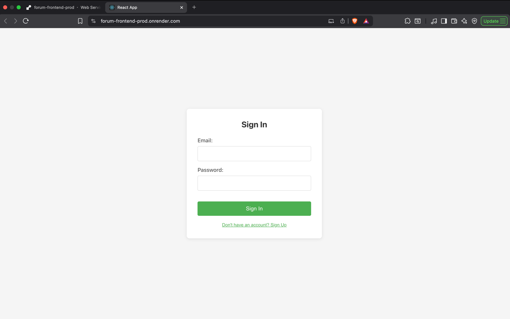

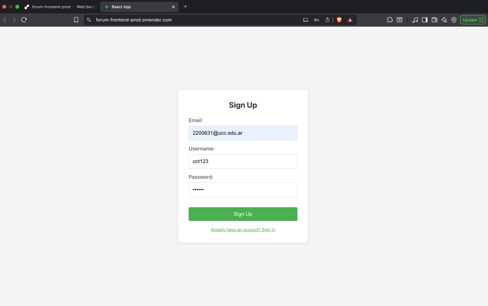

### Forum

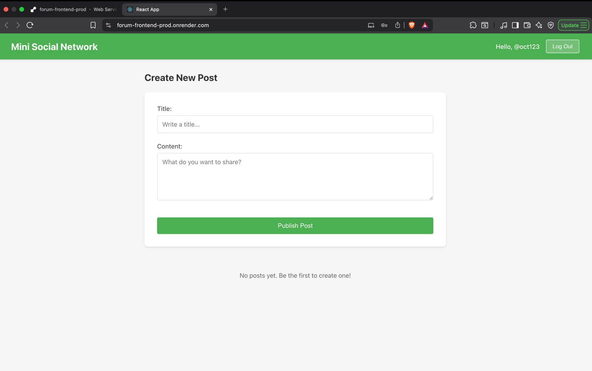

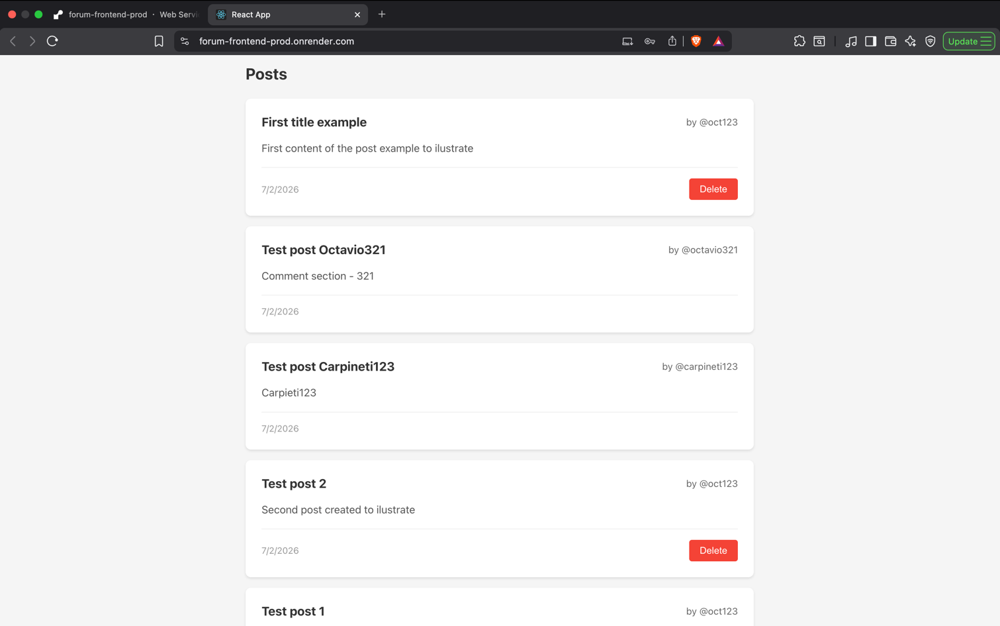

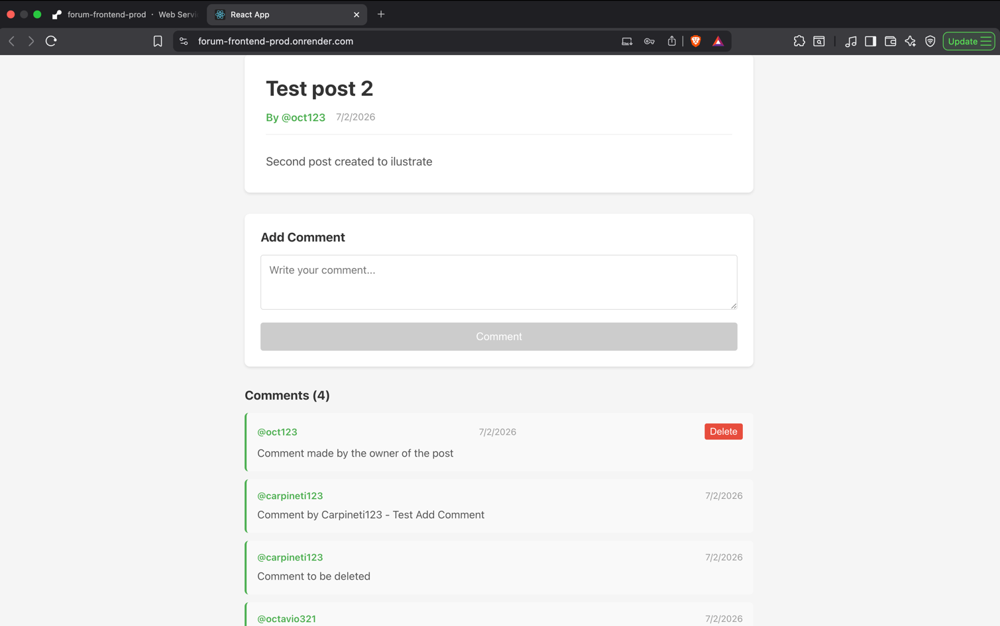

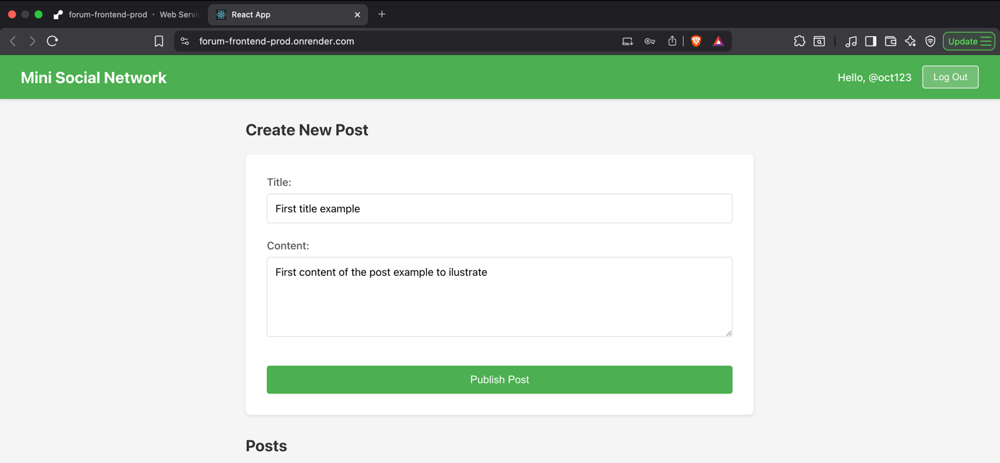

### Validations

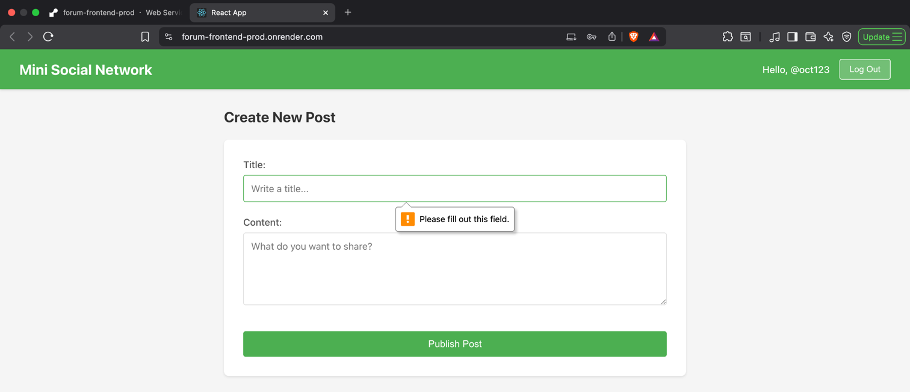

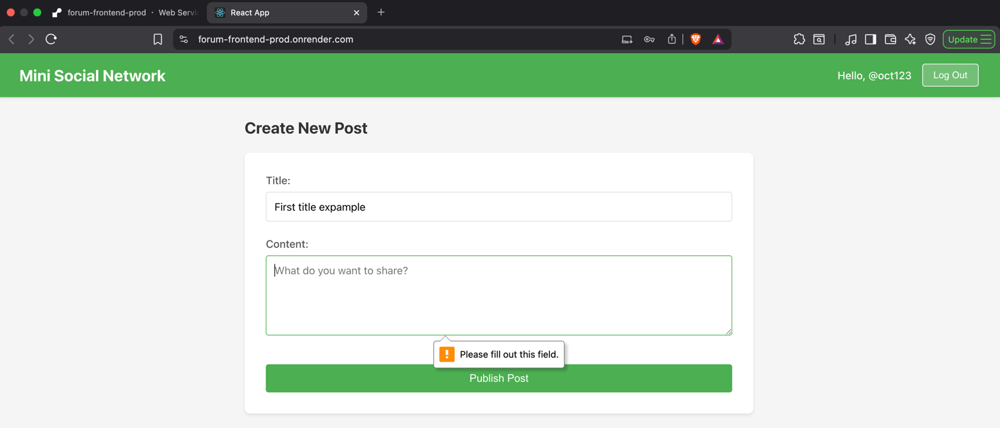

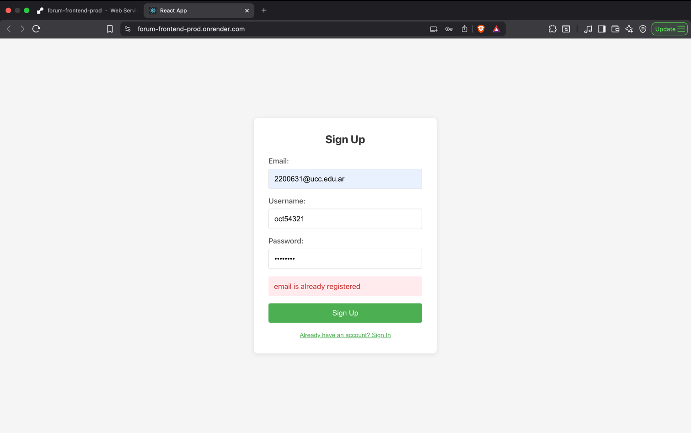

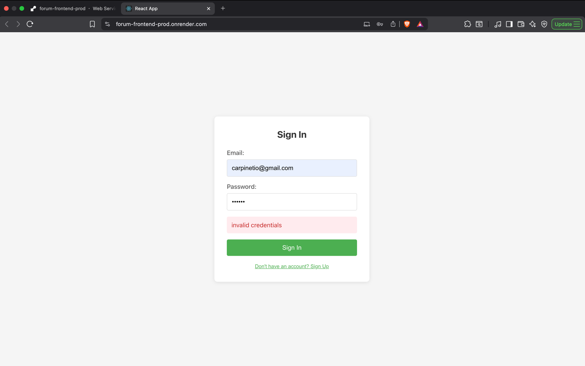

> The "invalid credentials" message is intentionally generic — it does not reveal whether the email exists, which is a standard security practice.

---

## Pipeline & Infrastructure

### Pipeline flow — stage order and quality gates


### Job structure — parallelism

Backend and frontend unit tests run in parallel. SonarCloud and Cypress wait for both to complete before starting, and also run in parallel with each other. Docker build only starts after all four quality gates pass.


### Artifact flow — Local → Registry → QA → PROD

A single Docker image is built once and promoted through environments. The approval gate exists so that PROD deployment is a deliberate decision — the image is ready when the code passes, but it ships when the moment is right.


### Pipeline in action

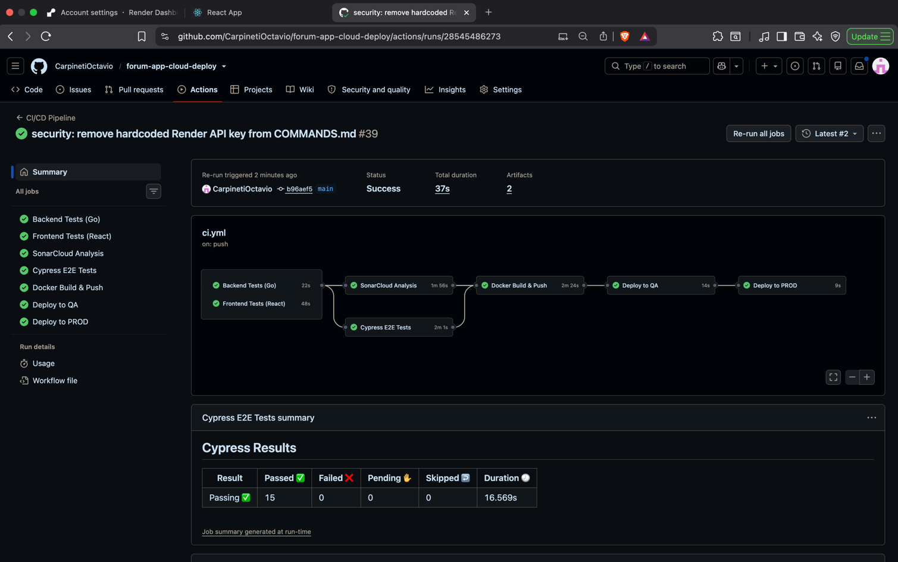

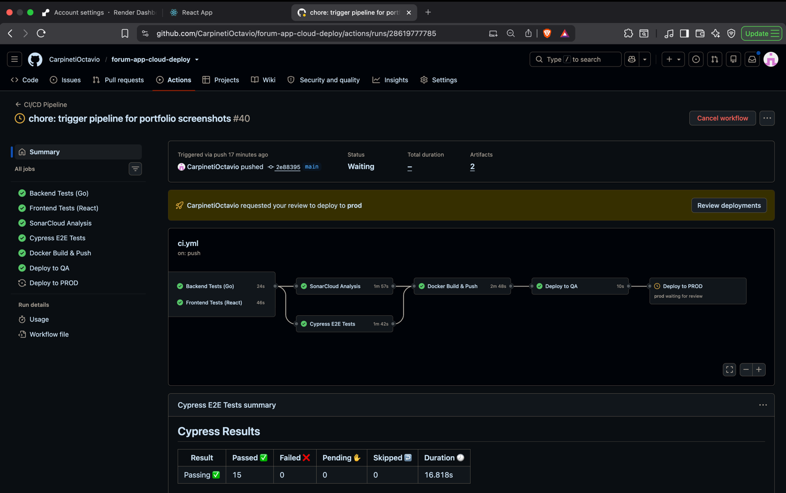

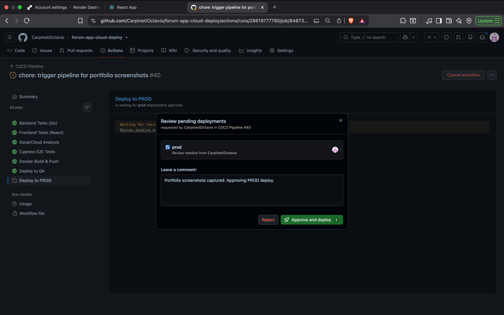

### SonarCloud quality gate

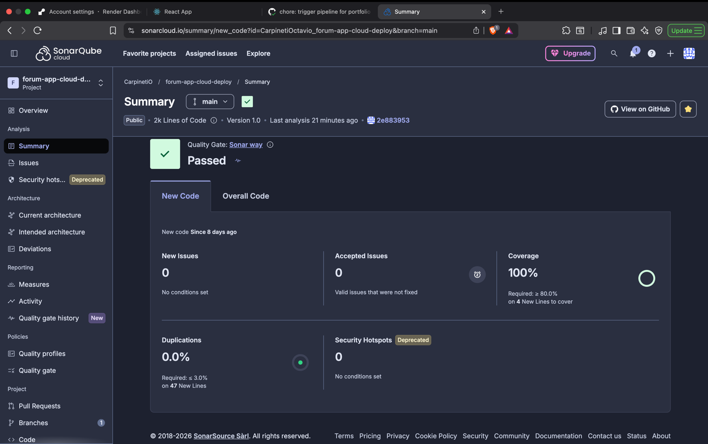

---

## Tech Stack

| Layer | Technology |
|-------|------------|
| Backend | Go 1.24 + SQLite |
| Frontend | React 18 + TypeScript |
| Unit Testing | Go testing + Jest |
| E2E Testing | Cypress |
| Static Analysis | SonarCloud |
| CI/CD | GitHub Actions |
| Containerization | Docker (multi-stage builds) |
| Container Registry | GitHub Container Registry (ghcr.io) |
| Cloud Hosting | Render.com (QA + PROD) |

---

## Prerequisites

```bash
go version     # 1.24 or higher
node --version # 22 or higher
npm --version  # 10 or higher
docker --version
```

**Installing Go:**
```bash
# macOS
brew install go
# Ubuntu/Debian
sudo apt install golang-go
# Windows: https://go.dev/dl/
```

**Installing Node.js:**
```bash
# macOS
brew install node
# Ubuntu/Debian
curl -fsSL https://deb.nodesource.com/setup_22.x | sudo -E bash -
sudo apt-get install -y nodejs
# Windows: https://nodejs.org/
```

---

## Installation

```bash
# URL corrected 2026-11-10 (repository renamed); see Update, item 7
git clone https://github.com/CarpinetiOctavio/forum-app-cloud-deploy-legacy.git
cd forum-app-cloud-deploy-legacy

cd backend && go mod download && cd ..
cd frontend && npm install && cd ..
```

---

## Running the Project

**Terminal 1 — Backend:**
```bash
cd backend
go run cmd/api/main.go
# Runs at http://localhost:8080
```

**Terminal 2 — Frontend:**
```bash
cd frontend
npm start
# Runs at http://localhost:3000
```

---

## Running Tests

### Backend unit tests

```bash
cd backend
go test ./tests/services/... -v
go test ./tests/services/... -v -cover -coverpkg=./internal/services/...
go test ./tests/services/... -coverprofile=coverage.out -coverpkg=./internal/services/...
go tool cover -html=coverage.out
go tool cover -func=coverage.out
```

Expected: all 47 tests pass, coverage ≥97%.

### Frontend unit tests

```bash
cd frontend
npm test -- --watchAll=false
npm test -- --coverage --watchAll=false
```

Expected: 47 tests pass, coverage ≥97%.

### E2E tests — Cypress

> Backend and frontend must be running first.

```bash
cd frontend
npx cypress run      # headless
npx cypress open     # interactive
```

Expected: 15 tests pass across 4 spec files.

---

## Quality Tools

### SonarCloud

```
https://sonarcloud.io/project/overview?id=CarpinetiOctavio_forum-app-cloud-deploy-legacy
```

### Code coverage

```bash
# Backend
cd backend
go test ./tests/services/... -coverprofile=coverage.out -coverpkg=./internal/services/...
go tool cover -func=coverage.out | grep total

# Frontend
cd frontend
npm test -- --coverage --watchAll=false
```

---

## CI/CD Pipeline

The pipeline triggers automatically on every push to `main`. *Incomplete: it also runs on pushes to `master` and `develop`; see [Update](#update-2026-11-10), item 3.*

**Stage order:**
1. Backend unit tests + coverage gate (≥70%)
2. Frontend unit tests + coverage gate (≥70%)
3. SonarCloud static analysis
4. Cypress E2E tests
5. Docker image build (multi-stage)
6. Push to ghcr.io — tagged with commit SHA
7. Deploy to QA (Render) — automatic
8. Manual approval gate
9. Deploy to PROD (Render) — requires explicit approval

If any of stages 1–4 fails, the pipeline aborts. No image is built and nothing is deployed.

**Trigger pipeline manually:**
```bash
git commit --allow-empty -m "chore: trigger pipeline"
git push origin main
```

---

## Docker & Cloud Deploy

### Building images locally

```bash
docker build -t forum-backend ./backend
docker build -t forum-frontend ./frontend
```

> **Apple Silicon note:** when pushing to ghcr.io manually, build with `--platform linux/amd64` — Render runs on amd64 and rejects arm64 images.

### Environments

| Aspect | QA | PROD |
|--------|----|------|
| Service | Render.com | Render.com |
| Docker image | Same image (same SHA tag) | Same image (same SHA tag) |
| Deploy | Automatic on passing tests | Requires manual approval |
| Credentials | QA environment variables | PROD environment variables |

### Image versioning

Images are tagged with the Git commit SHA (`${{ github.sha }}`), never `latest`. Every deployed image maps to an exact commit. Rollback is as simple as redeploying a previous tag — the image is already in the registry.

### Secrets

All sensitive values are stored as GitHub Secrets scoped to their environments (`qa` and `prod`). Nothing sensitive is hardcoded in Dockerfiles, workflow files, or documentation.

---

## Project Structure

```
forum-app-cloud-deploy/
├── backend/
│   ├── cmd/api/main.go                  # Server entry point
│   ├── internal/
│   │   ├── handlers/                    # HTTP handlers
│   │   ├── services/                    # Business logic (97.3% coverage)
│   │   ├── repository/                  # Data access interfaces
│   │   ├── models/                      # Data structures
│   │   ├── database/                    # Database configuration
│   │   └── router/                      # Route configuration
│   ├── tests/
│   │   ├── services/                    # 47 unit tests
│   │   └── mocks/                       # Test mocks
│   ├── .env.example
│   ├── Dockerfile                       # Multi-stage build
│   ├── go.mod
│   └── go.sum
├── frontend/
│   ├── src/
│   │   ├── components/                  # React components (97.64% coverage)
│   │   └── services/                    # HTTP services
│   ├── cypress/e2e/blog/                # 15 E2E tests
│   ├── .env.example
│   ├── Dockerfile                       # Multi-stage build
│   ├── docker-entrypoint.sh             # Runtime URL injection (see ADR-006)
│   └── package.json
├── .github/workflows/ci.yml             # Full CI/CD pipeline (9 stages)
├── docs/
│   ├── decisions/                       # Architecture Decision Records (ADR-001 to ADR-008)
│   ├── diagrams/                        # Pipeline and architecture diagrams
│   ├── screenshots/                     # App and pipeline screenshots
│   ├── rules/                           # AI assistant operating instructions
│   ├── SETUP.md                         # Infrastructure setup guide
│   └── COMMANDS.md                      # Command reference for local development and demos
├── sonar-project.properties
├── CLAUDE.md
└── README.md
```
--- 

## Documentation approach
This project was developed with Claude (Anthropic) as an AI assistant. CLAUDE.md is the context file that gives the assistant the full picture of the project at the start of every session — stack, structure, essential commands, and references to the rest of the docs. It exists so that nothing has to be assumed and no decision has to be re-explained from scratch.

docs/decisions/ contains eight Architecture Decision Records covering every significant technical choice made during the project: why GitHub Container Registry over Docker Hub, why commit SHA tagging over latest, how the frontend runtime URL injection works and why it was necessary, and what went wrong during the first pipeline run and how each problem was diagnosed and resolved. The intent is that anyone reading the repo — a recruiter, a collaborator, or a future version of the author — can understand not just what was built but why each decision was made, what alternatives were considered, and what the trade-offs were.

docs/rules/ defines how the assistant operates within this project: what it can modify autonomously, what requires explicit approval, and what is off-limits. Every architectural change went through a plan-first-execute-second workflow, with this conversation serving as the audit log.

---

## Troubleshooting

### Backend won't start
```bash
lsof -i :8080 && kill -9 <PID>
cd backend && rm go.sum && go mod tidy && go mod download
```

### Frontend won't start
```bash
lsof -i :3000
cd frontend && rm -rf node_modules package-lock.json && npm install
```

### Cypress tests fail
```bash
npx cypress cache clear && npx cypress install
DEBUG=cypress:* npx cypress run
```

### Pipeline fails
```bash
# package-lock.json out of sync
cd frontend && rm package-lock.json && npm install
git add package-lock.json && git commit -m "fix: regenerate package-lock.json"
```

---

## Metrics

| Metric | Target | Result | Status |
|--------|--------|--------|--------|
| Backend Coverage | ≥70% | 97.3% | ✅ |
| Frontend Coverage | ≥70% | 97.64% | ✅ |
| Total Tests | — | 109 (47 unit + 47 Jest + 15 E2E) | ✅ |
| SonarCloud Quality Gate | Pass | PASSED | ✅ |
| Issues Resolved | ≥3 | ~~47 issues~~ 6 (see [Update](#update-2026-11-10), item 2) | ✅ |
| Code Duplications | <3% | 0.0% | ✅ |

---

**Author:** Octavio Carpineti
**GitHub:** https://github.com/CarpinetiOctavio
**Repository:** https://github.com/CarpinetiOctavio/forum-app-cloud-deploy-legacy (corrected 2026-11-10; see [Update](#update-2026-11-10), item 7)